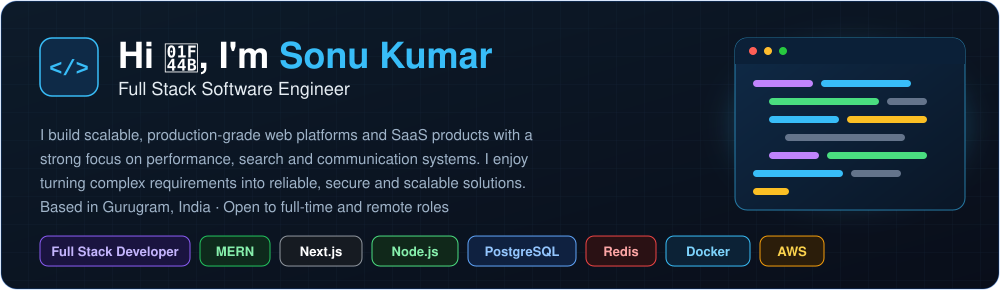

 

<table>
<tr>
<!-- ============ ABOUT ME ============ -->
<td width="50%" valign="top">

### 👤 About Me

- 💻 **4+ years** of experience in full stack development
- 🏢 Currently building **CommsHub** & **Ashniva Connect** (enterprise communication SaaS)
- 🏗️ Experienced in building scalable, multi-tenant and compliance-ready platforms
- ⚙️ Passionate about **DevOps, system design** and product engineering
- 🌱 Always learning and exploring new technologies

</td>

<!-- ============ TECH STACK ============ -->
<td width="50%" valign="top">

### 🛠️ Tech Stack

**Languages**&nbsp;&nbsp;&nbsp;  
**Frontend**&nbsp;&nbsp;&nbsp;&nbsp;  
**Backend**&nbsp;&nbsp;&nbsp;&nbsp;&nbsp;  
**Database**&nbsp;&nbsp;&nbsp;&nbsp;  
**DevOps**&nbsp;&nbsp;&nbsp;&nbsp;&nbsp;&nbsp;  
**Tools**&nbsp;&nbsp;&nbsp;&nbsp;&nbsp;&nbsp;&nbsp;&nbsp;

</td>
</tr>

<tr>
<!-- ============ FEATURED PROJECTS ============ -->
<td width="50%" valign="top">

### 🗂️ Featured Projects

**[CommsHub](https://github.com/sonuashniva445/commshub)** — Enterprise communication SaaS (SMS, WhatsApp, Email, Voice, OTP) with RBAC, KYC, billing, wallet & ledger.

**[Ashniva Connect](https://github.com/sonuashniva445/ashniva-connect)** — Multi-channel communication platform with DLT, routing, templates, webhooks & analytics architecture.

**[Carelix Meet](https://github.com/sonuashniva445/carelix-meet)** — Secure video meeting platform (WebRTC) with multi-device join, screen share and real-time collaboration.

</td>

<!-- ============ GITHUB STATS ============ -->
<td width="50%" valign="top">

### 📊 GitHub Stats

</td>
</tr>
</table>

 

<!-- ============ LET'S CONNECT ============ -->

### 🤝 Let's Connect

 

